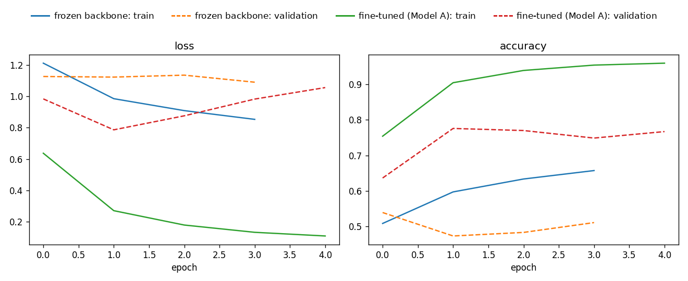
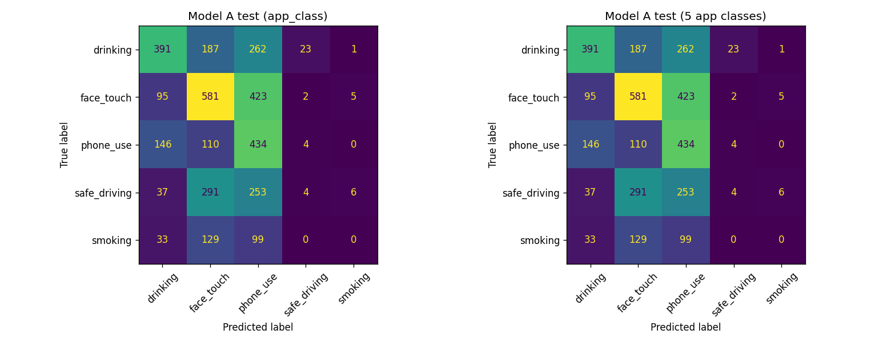
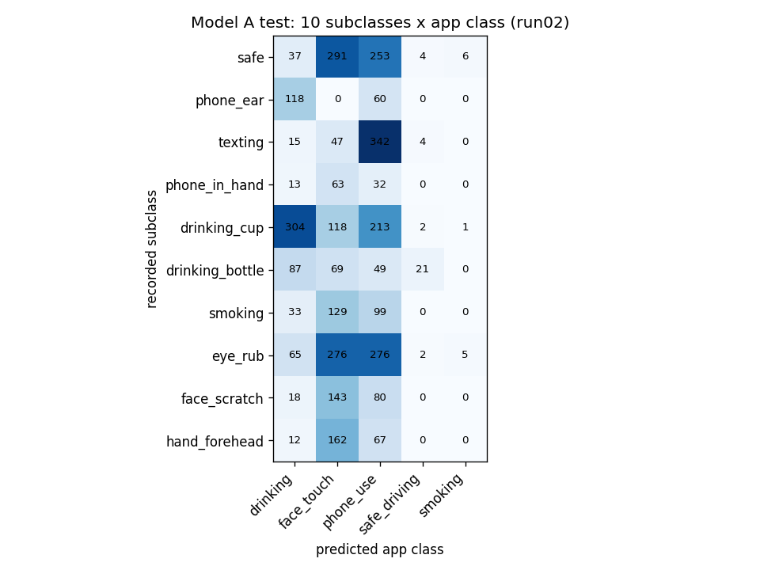

# driveaware-models

Model development code for **DriveAware** (CS663 Project 2): data preparation, Model A training,
Gemini fine-tuning, evaluation and system-test matching. App code lives in
[`driveaware-app`](https://github.com/PallikalaS/driveaware-app).

> Images, videos and model binaries never go to GitHub — they live in the shared Drive folder
> `DriveAware/` (and the GCS bucket for tuning). Commit CSVs, notebooks (with outputs) and results.

## Results and testing

### Model A: driver-activity classifier (fine-tuned MobileNetV3-Small)
Test set = **two team members never used in training** (3,516 frames); validation = the training subjects' held-back
clips. Notebook with outputs: [`notebooks/runs/model_a_run02.ipynb`](notebooks/runs/model_a_run02.ipynb).

| Model (same test set) | Test accuracy | Test macro-F1 | Val accuracy |
|---|---|---|---|
| CLIP ViT-B/32 zero-shot (pretrained, no training) | 0.547 | 0.457 | 0.540 |
| Frozen backbone (only the last layer trained) | 0.325 | 0.218 | 0.536 |
| **Fully fine-tuned (Model A, in the app)** | **0.401** | **0.279** | **0.773** |

Run history ([`model_a_runs.csv`](results/model_a/model_a_runs.csv)): run01 (State Farm only) 0.260 → **run02
(+ our team's clips) 0.401** test accuracy. Per class: [`run02_finetuned_per_class.csv`](results/model_a/run02_finetuned_per_class.csv)
(drinking F1 0.50, face touch 0.48, phone use 0.40; smoking and safe driving are the hardest). Data:
[`labels.csv`](results/model_a/labels.csv), [`class_counts.csv`](results/model_a/class_counts.csv).

**Training and validation loss and accuracy curves** (frozen backbone and fine-tuned; early stopping on validation accuracy):



| Confusion matrix (5 app classes) | Confusion matrix (10 subclasses) |
|---|---|
|  |  |

The gap between validation (0.77) and test (0.40) is the main finding: the model fits the people it was trained on
much better than new drivers (only two team members could be used for training, and the public State Farm images
come from a different camera angle). In the app, a 2-second / 70 %-of-frames rule and Gemini's re-check on the
keyframe limit the effect of single wrong predictions.

### Model B: fine-tuned Gemini 3.5 Flash (event verifier and driver message)
398 hand-labeled events (291 train / 56 val / 51 test; test events only from the held-out drivers), evaluated with
[`eval/gemini_eval.py`](eval/gemini_eval.py):

| Metric (51 test events) | Base Gemini 3.5 Flash | Tuned v1 (Nov 15) | **Tuned v2 (deployed)** |
|---|---|---|---|
| Event accuracy | 0.765 | 0.902 | **0.843** |
| Event macro-F1 | 0.690 | 0.833 | **0.769** |
| Severity accuracy | 0.745 | 0.961 | **0.922** |
| Action accuracy | 0.843 | 0.863 | **0.843** |
| Follows the labeling guide | 0.686 | 0.902 | **0.882** |
| Valid JSON | 1.000 | 1.000 | **1.000** |
| False-alarm precision / recall | 1.000 / 0.667 | 1.000 / 0.667 | **0.889 / 0.667** |
| Measured drowsiness signal dismissed (authority violations) | 0 | 0 | **0** |
| Latency median / 95th percentile | 1.9 s / 2.4 s | 2.5 s / 3.8 s | **2.9 s / 7.1 s** |

**15 test cases** (held-out drivers; ✓ = event and severity right, ½ = right event, wrong severity, ✗ = wrong event).
All 51 cases with full answers: [`base_predictions.csv`](results/gemini/base_predictions.csv),
[`tuned_v2_predictions.csv`](results/gemini/tuned_v2_predictions.csv).

| # | Trigger (from the phone) | Condition | Correct answer (event / severity) | Base Gemini | Tuned v2 | Tuned v2 message to the driver |
|---|---|---|---|---|---|---|
| 1 | `nod` | day, no glasses | **drowsy / medium** | early_fatigue / low ✗ | drowsy / medium ✓ | "Your head dropped forward, so consider taking a break soon." |
| 2 | `gaze_away` | day, no glasses | **distracted_gaze / low** | drowsy / high ✗ | distracted_gaze / low ✓ | "Eyes back on the road, please." |
| 3 | `perclos_high` | day, no glasses | **drowsy / medium** | early_fatigue / low ✗ | drowsy / high ½ | "You're showing signs of severe fatigue, so please pull over safely and rest." |
| 4 | `smoking` | day, no glasses | **smoking / low** | smoking / medium ½ | smoking / low ✓ | "Keep your hands on the wheel and your eyes on the road." |
| 5 | `phone_use` | night, no glasses | **false_alarm / low** | false_alarm / low ✓ | false_alarm / low ✓ | "No alert needed." |
| 6 | `phone_use` | day, no glasses | **distracted_phone / high** | distracted_phone / high ✓ | distracted_phone / high ✓ | "Put the phone down and keep your eyes on the road." |
| 7 | `phone_use` | day, no glasses | **distracted_phone / medium** | distracted_phone / medium ✓ | distracted_phone / medium ✓ | "Please end the call or go hands-free, and keep your eyes on the road." |
| 8 | `eye_closure_long` | day, no glasses | **drowsy / high** | drowsy / high ✓ | drowsy / high ✓ | "Your eyes closed for over a second, so please pull over safely and rest." |
| 9 | `yawn` | day, no glasses | **early_fatigue / low** | early_fatigue / low ✓ | early_fatigue / low ✓ | "You're yawning, so stay alert and plan a break if you feel tired." |
| 10 | `nod` | night, sunglasses | **drowsy / medium** | drowsy / medium ✓ | drowsy / medium ✓ | "Your head dropped forward, so consider taking a break soon." |
| 11 | `face_touch` | day, clear glasses | **drowsy / medium** | drowsy / medium ✓ | early_fatigue / low ✗ | "You seem a little tired, so consider a short break soon." |
| 12 | `drinking` | day, no glasses | **false_alarm / low** | drinking / low ✗ | drinking / low ✗ | "Keep at least one hand on the wheel while you drink." |
| 13 | `smoking` | day, no glasses | **smoking / low** | early_fatigue / low ✗ | false_alarm / low ✗ | "No alert needed." |
| 14 | `yawn` | day, clear glasses | **early_fatigue / low** | drowsy / high ✗ | drowsy / high ✗ | "Your eyes closed for over a second, so please pull over safely and rest." |
| 15 | `face_touch` | day, sunglasses | **false_alarm / low** | false_alarm / low ✓ | early_fatigue / low ✗ | "You seem a little tired, so consider a short break soon." |

**What the cases show.** Tuning fixed the base model's most dangerous habit, softening a real drowsiness signal
into "early fatigue" (cases 1 and 3), and its confusion of looking away with closed eyes (case 2). It also taught the
model our severity rules and fixed messages (cases 4 and 5): the base model broke a guide rule in 16 of 51 answers (31 %), and never used the guide's exact driver messages.
**Why the failures happen:** in case 12 the bottle is in the frame but not at the mouth, and one still image can't show
whether the driver is about to drink. In case 13 the cigarette is small and partly hidden by the hand. In case 14 the
eyes are squeezed shut during the yawn, so the image looks like an eye closure. Case 15 is a borderline face touch
with sunglasses, where the eyes can't be seen. Cases 11 and 15 show the tuned model leaning toward "early fatigue"
for face touches, a pattern from the training labels.

Tuned v1 was deleted by Google when our course cloud credit ran out on Nov 18; v2 was re-tuned on the same data and is
the model used in the app and the system tests. The two runs show normal run-to-run variation of fine-tuning.
Training loss curves are not shown: the Vertex AI console does not display them for tuning jobs in the `us`
multi-region, the only region where Gemini 3.5 Flash can be tuned.

### Detection thresholds (tuned on validation clips only)
[`results/tuning/thresholds.csv`](results/tuning/thresholds.csv): start vs. final values. Tuning on V01–V04 raised yawn
recall from 0.2 to 0.8, macro-F1 from 0.49 to 0.69, and cut false alarms from 11 to 7.

### Full-system tests
_Results of the 8 scripted sessions with the held-out drivers (`eval/match_events.py`) are added in `results/system/`._

## Pipeline end to end

| Step | Command | Output |
|---|---|---|
| Model A data | `scripts/extract_frames.py` (team clips + State Farm) | `Frames/` 224 px crops + `labels.csv` |
| Model A train + eval | `notebooks/model_a_training.ipynb` (Colab, GPU) | CLIP / frozen / fine-tuned metrics, `model_a.tflite` in `Results/model_a/` |
| Gemini label sheet | `scripts/build_label_sheet.py` → `scripts/trim_label_sheet.py` | `label_sheet_trimmed.csv` + keyframes for Bindu |
| Gemini tuning data | `scripts/sheet_to_jsonl.py` (validates every row) | `train.jsonl`, `val.jsonl`, `test.jsonl` |
| Gemini tuning | `scripts/gemini_tuning.py upload / tune / status` | tuned endpoint + backend redeploy command |
| Gemini eval | `eval/gemini_eval.py run` (base, tuned) → `compare` | `comparison.md`, predictions CSVs |
| Thresholds | `scripts/tune_thresholds.py` on V01–V03 | `thresholds.csv` (start vs suggested) |
| System test | `eval/match_events.py` on S01–S08 logs | recall, precision, false alarms / 10 min, delay |

## Layout

| Path | What | Owner |
|---|---|---|
| `driveaware_data/labels.py` | Every label word (classes, event types, Gemini sheet words), clip-name parser, public-dataset mapping, subject split | Swathi |
| `driveaware_data/crop.py` | Center vs dynamic upper-body crop (same geometry as the app) | Swathi |
| `scripts/extract_frames.py` | Clips/images → 224×224 frames + pre-filled `labels.csv` + `class_counts.csv` | Swathi wrote · Mahitha runs |
| `scripts/crop_compare.py` | Side-by-side crop images for choosing the crop | Swathi wrote · Mahitha runs |
| `driveaware_data/signals.py` | Python port of the app's rules (EAR/MAR/pose, TemporalEngine, calibration), kept in step with the Kotlin | Swathi |
| `scripts/replay_clip.py` | Replay recorded clips through Model C + rules → per-frame CSV + app-format event log (threshold tuning) | Swathi wrote · Vanessa runs |
| `scripts/build_label_sheet.py` | Clips → Gemini label-sheet rows (keyframe + exact backend signal line) | Swathi wrote · Swathi/Bindu run |
| `eval/match_events.py` | App event log vs scripted session CSV → recall, precision, false alarms/10 min, delay | Swathi wrote · Vanessa runs |
| `scripts/trim_label_sheet.py` | Right-size the built sheet: pilot rows to test, stratified test sample | Swathi |
| `driveaware_data/gemini_rows.py` | Backend signal line, system instruction, labeling-guide checks (train == serve) | Swathi |
| `scripts/sheet_to_jsonl.py` | Final label sheet → Vertex AI tuning JSONL | Swathi |
| `scripts/gemini_tuning.py` | Upload to the bucket, start and watch the tuning job | Swathi |
| `eval/gemini_eval.py` | Base vs tuned Gemini on the held-out rows | Swathi wrote · Bindu runs |
| `scripts/tune_thresholds.py` | Score threshold values on V01–V03 against Vanessa's scripts | Swathi wrote · Vanessa reviews |
| `infra/gcp_setup.sh` | Project, billing budget, APIs, bucket, service account, teammate IAM | Swathi |
| `notebooks/model_a_training.ipynb` | Model A training + CLIP / frozen baselines + evaluation (Colab) | Swathi wrote · Mahitha runs |
| `schema/`, `results/` | Gemini JSON schema; committed metrics, curves, confusion matrices | |
| `tests/` | `pytest -q` | |

## Setup

```bash
python3 -m venv .venv && source .venv/bin/activate
pip install -r requirements.txt
pytest -q
```

Face detection for the dynamic crop: download MediaPipe's
`blaze_face_short_range.tflite` and pass `--face-model path/to/it`. Without it the scripts fall back
to OpenCV's Haar cascade, and if that is missing too, to a center crop (rows are marked
`center_fallback` in `labels.csv`).

## Mahitha — Wed: crop choice, frames, labels

```bash
# 1. crop comparison on 3–4 clips (include texting held low) → post the images on Discord
python scripts/crop_compare.py ~/Drive/DriveAware/Team_raw/*texting*.mp4 --face-model blaze_face_short_range.tflite

# 2. frames for everything (team + public); held-out members land in split=test automatically
python scripts/extract_frames.py \
  --team ~/Drive/DriveAware/Team_raw ~/Drive/DriveAware/Team_test_only \
  --public ~/Drive/DriveAware/StateFarm_raw/imgs/train --public-source statefarm \
  --out ~/Drive/DriveAware/Frames --crop dynamic --fps 2 --held-out mahitha,vanessa \
  --face-model blaze_face_short_range.tflite
```
Options: `--skip-start-s 5` (default; drops the look-ahead seconds at the start of every non-safe
clip), `--team-val-frac 0.15` (default; whole team clips per training person go to val, so the
validation score reflects our phone camera, not only State Farm), `--spans activity_spans.csv`
(`clip,start_s,end_s`, several rows per clip: keep only frames where the activity is really
happening, for clips where it happens on and off).

Then fix the `subclass` column in `Frames/labels.csv`, and commit `labels.csv` + `class_counts.csv`
to `data/`. Clip names must be `name_activity_condition_tN.mp4` (lowercase; `.mov` / `.MOV` from
iPhones also work); badly named clips are skipped with a message.

**Public-label mapping** (`driveaware_data/labels.py`): State Farm c0 safe, c1/c3 texting,
c2/c4 phone_ear, c6 drinking_cup, c8 hand_forehead; c5 radio, c7 reaching behind, c9 passenger are
dropped. Public data is train/val only; **test = held-out team members only**.

## Vanessa — event CSV questions (answered)

1. **`event_type=none` for normal driving?** Yes. Every `none` row is a stretch of plain driving;
   any alert inside it counts as a false alarm, and the total `none` time is the denominator for
   *false alarms per 10 min*. Make the `none` rows add up to ≥ 8 min across the 8 sessions.
2. **Partial occlusion / mount angle?** Keep `event_type` as the real behaviour and put tags in
   `notes`: `occlusion=hand; mount=B`. The script reports recall broken down by every tag key it
   finds, so you get occlusion and mount-angle results for free.
3. **Filenames starting with the session id?** Yes, `S01_mahitha_day-none.mp4` is fine. Name the
   CSV `S01.csv` and the exported app log `S01_log_*.csv` so `--script-dir/--log-dir` pairs them.
4. **`start_s`/`end_s` used as written?** Yes, seconds from video start. A detection counts if the
   app alert of the same type starts between `start_s − 1 s` and `end_s + 3 s`
   (`--pre/--post`). Detection delay = alert time − `start_s`. Start the app and the recording
   together; if they're off, pass `--offset`.
5. `mirror_check` rows must **not** alert — an alert there is reported as a false alarm.

```bash
python eval/match_events.py --script-dir ../driveaware-app/tests/scripts \
  --log-dir ~/Drive/DriveAware/Test_sessions --out results/system
```
Outputs `per_behavior.csv`, `summary.csv`, `by_condition.csv`, `matched_events.csv` (add a
`failed_stage` column for misses: `face_not_found / wrong_class / rule_threshold /
wrong_gemini_verdict`) and `classified_alerts.csv`.

## Google Cloud

```bash
PROJECT_ID=driveaware-cs663 BILLING_ACCOUNT=XXXXXX-XXXXXX-XXXXXX bash infra/gcp_setup.sh
```
Creates the project, a $50 budget alert, enables Vertex AI / Cloud Run / Cloud Build / Artifact
Registry / Cloud Storage, bucket `gs://<project>-data`, the `driveaware-backend` service account
(roles/aiplatform.user, no keys) and gives teammates Vertex AI Studio + bucket access.

**Gemini model for tuning (task #4, confirmed Nov 11, 2026):**

| Field | Value |
|---|---|
| Tunable model ID | `gemini-3.5-flash` (GA on Vertex AI, retirement May 19, 2027 or later) |
| Tuning location | `us` multi-region (3.5 Flash tunes on `us` / `eu` only) |
| Tuned-model serving | `us` (also `eu`, `global`) |
| Thinking | `MINIMAL` for the tuned task |
| Limits | 131,072 tokens per example; up to 300K multimodal examples; JSONL ≤ 1 GB |

`gemini-2.5-flash` was retired on Vertex AI on Oct 20, 2026, so it can't be used for the base
check or tuning. Use **Vertex AI Studio** (console.cloud.google.com) for the base check, not
Google AI Studio, where `gemini-3.5-flash` is deprecated and silently routed to 3.6 Flash.

## Replay and Gemini label sheet

Both need Google's Face Landmarker file (same as the app). Download once:
```bash
curl -fsSL -o face_landmarker.task \
  https://storage.googleapis.com/mediapipe-models/face_landmarker/face_landmarker/float16/1/face_landmarker.task
```

**Threshold tuning (Vanessa, validation clips only):**
```bash
python scripts/replay_clip.py ~/Drive/DriveAware/Team_validation/V0*.mp4 --model face_landmarker.task --out results/replay
python eval/match_events.py --script-dir ../driveaware-app/tests/validation --log-dir results/replay --out results/validation_match
# try a change:  --set long_closure_s=0.8 --set gaze_max_s=2.5   (names as in driveaware_data/signals.py)
```
Each clip's first 10 s are used as calibration (the V0x scripts start with 15 s of looking forward).

**Gemini label sheet (Bindu labels these rows):**
```bash
python scripts/build_label_sheet.py ~/Drive/DriveAware/Team_raw ~/Drive/DriveAware/Team_test_only \
  ~/Drive/DriveAware/Team_validation --val-dir ~/Drive/DriveAware/Team_validation \
  --model face_landmarker.task --out ~/Drive/DriveAware/Gemini_events
```
`--val-dir`: clips in that folder (Bindu's V01–V03) become **val** rows, so tuning has a validation set
with only two training people. Adding clips later (e.g. one person's recordings arrive a day late): run
on just those clips with `--id-prefix b`; it writes `label_sheet_b.csv` with row ids `b0001…`, which you
append to the Google Sheet without clashing with the first batch.
Writes `label_sheet.csv` + `keyframes/`. Import the CSV into Google Sheets (File → Import), keep
`keyframes/` next to it in Drive. Rows come from the rules (`rules`), from activity clips standing in
for Model A (`clip_label`, model_a conf 0.00 until `model_a_v1.tflite` exists; regenerate these rows
then) and phone-use triggers on non-phone frames as false-alarm candidates (`confusion`). Held-out
members' clips (incl. Vanessa's pilot recordings in `Team_test_only/pilot/`) become **test** rows.

## Gemini tuning data and evaluation

**Sheet → JSONL (#22):** export Bindu's final sheet as CSV, then
```
python scripts/sheet_to_jsonl.py label_sheet_final.csv \
    --image-prefix gs://driveaware-cs663-swathi-data/gemini/keyframes \
    --keyframes ~/Drive/DriveAware/Gemini_events/keyframes --out ~/Drive/DriveAware/Gemini_events/jsonl
```
Every row is checked against `labeling_guide.md` (allowed words, authority rule, section 4 severity/action
table, sunglasses cap, message rules); any bad row stops the run and is listed by sheet row number.
Writes `train.jsonl` / `val.jsonl` (tuning) and `test.jsonl` (held-out, evaluation only) in the Vertex AI
format: system instruction + image + signal line → compact JSON answer, same order as the backend sends.

**Upload and tune (#23, #24, #31):**
```
python scripts/gemini_tuning.py upload --keyframes <Gemini_events>/keyframes --jsonl <Gemini_events>/jsonl
python scripts/gemini_tuning.py tune          # base gemini-3.5-flash, location us, train + val JSONL
python scripts/gemini_tuning.py status --wait # prints the tuned endpoint and the backend redeploy command
```
`upload` checks every image URI points into the bucket and warns below 100 training rows (Vertex AI
recommends 100–500). Gemini 3+ tuning runs on the `us` multi-region endpoint (`us-central1` is only
for Gemini 2.5 and earlier), and the tuned model is served from `us`, the backend's default location.

**Base vs tuned (#29):** `pip install google-genai`, `gcloud auth application-default login`, then
```
python eval/gemini_eval.py run test.jsonl --model gemini-3.5-flash --name base
python eval/gemini_eval.py run test.jsonl --model projects/<num>/locations/us/endpoints/<id> --name tuned
python eval/gemini_eval.py compare results/gemini/base_predictions.csv results/gemini/tuned_predictions.csv
```
Reports event accuracy / macro-F1, false_alarm precision and recall, severity / action accuracy,
valid-JSON and guide-valid rates, authority-rule violations and latency p50/p95 (`comparison.md` for the report).

## Threshold tuning on V01–V03 (Vanessa #14/#15, app #36)
```
python scripts/tune_thresholds.py ~/Projects/driveaware/data/Team_validation \
    --scripts ~/Projects/driveaware/driveaware-app/tests/validation \
    --model face_landmarker.task --out results/tuning
```
Runs the face model once per V clip (cached), then replays the app's rules for every candidate
value of each threshold, one at a time from the defaults (2 rounds), and scores each against
Vanessa's V0x.csv scripts with the system-test matching. Writes `tuning_table.csv` (every value
tried), `thresholds.csv` (start vs suggested, with the app setting name) and `baseline_report.txt`.
Only rule events are scored; eye events are skipped on sunglasses clips (the app's degraded mode).
